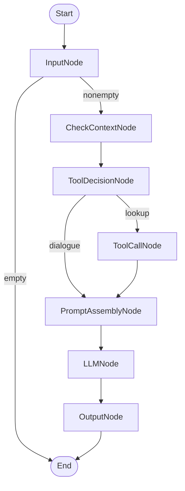

# Adam NPC dialogue engine

Adam is an RPG guide. The MCP server stores conversation memory and gives the
LangGraph client tools to retrieve context and search Wikipedia. The local vLLM
chat endpoint generates dialogue, search queries, summaries, and facts. It also
classifies older turns by importance. The local SystemOne service handles routing,
Wikipedia candidate selection, and memory ranking.

Adam's persona is a wise, centuries-old sage of the northern isles. He gives
empathetic advice and remembers the player's name, goals, preferences, and promises.
The second persona, Mira, is an island cartographer.

## Install the project

Use Python 3.11 or newer. Open a terminal in the extracted project directory, then run:

```sh
curl -LsSf https://astral.sh/uv/install.sh | sh
uv sync
source .venv/bin/activate
```

## Run the services in order

Start the chat model and decision service before the MCP server and dialogue
client. Keep the model services and MCP server running while you use the client.

### 1. Start the model services in separate terminals

Start your model runtime with these settings:

- Chat model: `mlx-community/Llama-3.2-3B-Instruct-4bit`
- Chat endpoint: `http://127.0.0.1:8000/v1/chat/completions`
- Chat tokenization endpoint: `http://127.0.0.1:8000/tokenize`

```
vllm serve mlx-community/Llama-3.2-3B-Instruct-4bit --max-model-len 8000
```

- Decision model: `vllm-sr/Decision-2.0-Kai-0.6B`

```
curl -fsSL https://vllm-sr.ai/install.sh | bash -s -- --channel dev --no-launch
export PATH="$HOME/.local/bin:$PATH"
vllm-sr serve vllm-sr/Decision-2.0-Kai-0.6B
```

### 2. Start the MCP server in another terminal

```sh
source .venv/bin/activate
export WIKIPEDIA_USER_AGENT='AdamDialogueAssessment/1.0 (mailto:your.email@gmail.com)'
python mcp_server.py
```

Wait for this log line, and leave the terminal open:

```text
Uvicorn running on http://127.0.0.1:8001
```

If the port is already occupied, check for an existing server before starting
another copy:

```sh
lsof -nP -iTCP:8001 -sTCP:LISTEN
```

### 3. Run the client in another terminal

```sh
source .venv/bin/activate
python mcp_client.py --player rowan --url http://127.0.0.1:8001/mcp
```

At `Player>`, enter a message such as:

```text
My name is Rowan. I want to find the lost lighthouse. I prefer avoiding combat.
```

Then try a factual question:

```text
What are the different genres in gaming?
```

The client prints Adam's reply. Add `--debug` to show the graph route, prompt token
count, and Wikipedia result. The client ignores empty input.
Type `/quit` or `/exit` to stop the client.

Press Ctrl+C in a server's terminal to stop it. Stopping the MCP server clears all
conversation memory. Clients can reconnect to their conversations while the same
server process runs.

## Run the six-turn demo

With the services running, capture a dialogue:

```sh
python mcp_client.py --player demo --debug --demo examples/player_turns.txt \
  | tee examples/live_transcript.txt
```

For a longer memory check, follow the [20-turn memory stress run](examples/memory_stress.md).

## Run multiple personas

With the model services and MCP server running, use `--npc adam` for the sage or
`--npc mira` for the cartographer. Both clients use the same services.

To talk to both at once, open two terminals in the project directory. Start Adam
in the first terminal:

```sh
source .venv/bin/activate
python mcp_client.py --player rowan --npc adam --url http://127.0.0.1:8001/mcp
```

In the second terminal, start Mira:

```sh
source .venv/bin/activate
python mcp_client.py --player rowan --npc mira --url http://127.0.0.1:8001/mcp
```

Enter messages at each terminal's `Player>` prompt. Adam's replies begin with
`Adam>`. Mira's replies begin with `Mira>`.

Each player and NPC pair has separate memory. Mira cannot recall your conversation
with Adam, even when both clients use `--player rowan`. To resume a conversation,
restart the client with the same `--player` and `--npc`. The MCP server must still
be running. For another player, use a different `--player` value.

To clear only Rowan's conversation with Mira, exit the Mira client and restart it
with `--reset`:

```sh
python mcp_client.py --player rowan --npc mira --reset --url http://127.0.0.1:8001/mcp
```

To add a persona, follow [Configure NPCs](#configure-npcs). Select its registry key
with `--npc`.

## Configure NPCs

`NPCS` in `npc_runtime.py` is the character registry. Each `NPCProfile` defines the NPC
name, persona instructions, reply budget, summary budget, recent-message window,
and fact limit. You cannot change a profile after creation. Its schema
validates the budgets. All NPCs require evidence for factual answers and treat
quoted data as untrusted.

| Setting | Adam | Mira |
| --- | --- | --- |
| Reply token reserve | 900 | 450 |
| Summary token limit | 600 | 400 |
| Normal recent messages | 4 | 2 |
| Candidate facts | 32 | 16 |

Add another registry entry to make a character available to the CLI and server:

```python
"tor": NPCProfile(
    name="Tor",
    persona="A patient island blacksmith. Give practical repair advice.",
    output_tokens=300,
    summary_tokens=256,
    recent_messages=2,
    fact_limit=8,
),
```

Restart the client and server from the same checkout after changing the registry.
Each player and NPC pair has separate memory, revisions, commit receipts, and
locks. Fact extraction uses the NPC's registered name. All NPCs use the same model
context limit and generation checks.

## Configure the application

The default settings use the service addresses above.
To change a setting, export it in both the MCP server and client terminals before startup.
The application does not automatically load `.env` or `.env.example`.

| Variable | Default | Purpose |
| --- | --- | --- |
| `VLLM_BASE_URL` | `http://127.0.0.1:8000/v1` | Local chat API base URL. |
| `SYSTEMONE_URL` | `http://localhost:8899/v1/systemone` | Routing, Wikipedia selection, and memory ranking endpoint. |
| `DECISION_MODEL` | `vllm-sr/Decision-2.0-Kai-0.6B` | Local decision model. |
| `VLLM_MODEL` | `mlx-community/Llama-3.2-3B-Instruct-4bit` | Served model name. |
| `VLLM_API_KEY` | `local` when unset or empty | Optional model-service authentication. |
| `VLLM_TOKENIZE_URL` | Chat base URL without `/v1`, followed by `/tokenize` | Chat-template token-count endpoint. |
| `CHAT_TOKENIZER` | `VLLM_MODEL` | Hugging Face tokenizer ID or local `tokenizer.json` path. |
| `PORT` | `8001` | MCP server port. |
| `MCP_URL` | `http://127.0.0.1:8001/mcp` | Client's MCP URL. `--url` overrides it. |
| `WIKIPEDIA_USER_AGENT` | `AdamDialogueAssessment/1.0 (educational local demo)` | Wikipedia client identification. Set real contact information in the MCP server's environment. |

For example:

```sh
export VLLM_BASE_URL=http://127.0.0.1:8000/v1
export VLLM_MODEL=mlx-community/Llama-3.2-3B-Instruct-4bit
```

For offline content tokenization, set `CHAT_TOKENIZER` to the matching local
`tokenizer.json`. Otherwise, the Hugging Face tokenizer downloads on first use.
Use the same model and tokenizer configuration in both terminals.

See [.env.example](.env.example) for the settings. The application no longer reads
`OPENAI_MODEL`. It uses the OpenAI Python SDK to call local vLLM.

## Understand the implementation

The LangGraph client manages the conversation flow. The MCP server stores memory
and provides the Wikipedia lookup tool. Local models generate dialogue, summarize
text, and decide which information is relevant.

### How memory works

The server keeps separate memory for each player and NPC pair. One player can talk
to Adam and Mira at the same time, with an independent conversation for each NPC.

Memory contains the original messages, recent dialogue, a summary of older turns,
and extracted facts such as the player's name, goals, and promises. Before each
reply, the server selects relevant facts and older passages, then combines them
with the NPC persona and current message.

The server checks that the prompt and reply reserve fit the model's 4096-token
limit. When needed, it summarizes older turns or leaves less relevant memory out
of the prompt. Original messages stay in memory, so summarization does not delete
conversation history. Summaries and extracted facts can still contain model errors.

After answering, the client saves the player message and NPC reply together through
`COMMIT_TURN`. A revision check prevents an older request from overwriting newer
conversation state. Retrying the same completed turn does not duplicate it.

Memory stays in RAM without a retention cap. Reset clears one conversation, and
restarting the server clears all conversations.

### How the Wikipedia tool call works

The decision model checks whether the current request needs real-world information.
It uses earlier dialogue to resolve references and distinguish story updates from
real-world questions. Name corrections, inventory changes, and fictional claims
use dialogue. Mentioning an unverified story claim does not request a lookup.
If earlier dialogue already contains the answer, the client can use that context.
Otherwise:

1. The chat model creates a search query from the request and conversation context.
   For example, after discussing Julius Caesar, "When did he die?" becomes
   "Julius Caesar death date".
2. The client calls `TOOL_CALL` through MCP. The server searches Wikipedia for
   candidate pages.
3. The decision model ranks the candidates and picks the highest-ranked page.
   The server makes a second API request to fetch that article's text.
4. The server sends up to 1,600 source tokens to the chat model. The model
   summarizes only that source, aiming for 100 words with a hard limit of 512 tokens.
   The client adds the summary and URL to the conversation prompt as quoted evidence.
   The chat model answers the player's question in character and cites the URL.
5. The client saves the completed turn to that player's memory with the selected NPC.

After a successful lookup, one additional model call combines conversation context
with the evidence. The prompt tells the NPC to use only the evidence for new
real-world facts and say when it does not answer the question. The client checks
the combined prompt budget and reduces the reply reserve if needed. Source
summaries and final replies may contain model errors.

If lookup fails, the NPC continues from the player's message and conversation
memory. It acknowledges story updates. For real-world questions, the prompt tells
the NPC to explain that it could not verify the answer and to avoid invented facts
or citations. The client checks the fallback prompt against the token budget.

For example, "My sister's name is Elyn, not Elin" updates the
player's story. If the router sends that message to Wikipedia and the search finds no article,
the NPC still responds to the correction. A failed lookup does not prevent the
client from saving the player message and NPC reply together.

The optional native mode lets the chat model request the same lookup through a
function call. The MCP server still executes the tool and manages memory:

```sh
python mcp_client.py --player rowan --native-tools --debug
```


### Turn workflow



For dialogue, `PromptAssemblyNode` checks the prompt budget, and `LLMNode` generates
a reply using the NPC persona. Successful lookups add quoted evidence and its URL
to the prompt. For failed lookups, the client adds the failure instructions to the prompt
and generates an NPC reply within the token budget. `OutputNode` saves the completed turn using the original context
revision. The server rejects the commit if the conversation has changed.

## Find the code

| File | Responsibility |
| --- | --- |
| [mcp_client.py](mcp_client.py) | CLI, LangGraph workflow, and MCP client. |
| [mcp_server.py](mcp_server.py) | MCP tools, conversation storage, fact selection, and history compaction. |
| [npc_runtime.py](npc_runtime.py) | Personas, prompts, token budgets, completions, summaries, fact extraction, and Wikipedia lookup. |
| [schemas.py](schemas.py) | Shared message, memory, routing, and MCP result types. |
| [pyproject.toml](pyproject.toml) | Runtime dependencies and package settings. |

Protocol references: [MCP Python SDK](https://github.com/modelcontextprotocol/python-sdk/tree/v1.x),
[LangGraph graph API](https://docs.langchain.com/oss/python/langgraph/graph-api), and
[vLLM chat tokenization](https://docs.vllm.ai/en/latest/api/vllm/entrypoints/serve/tokenize/protocol/).
